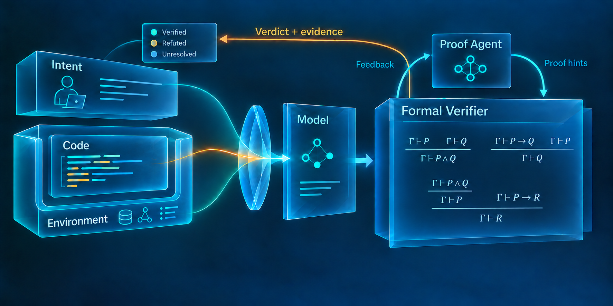
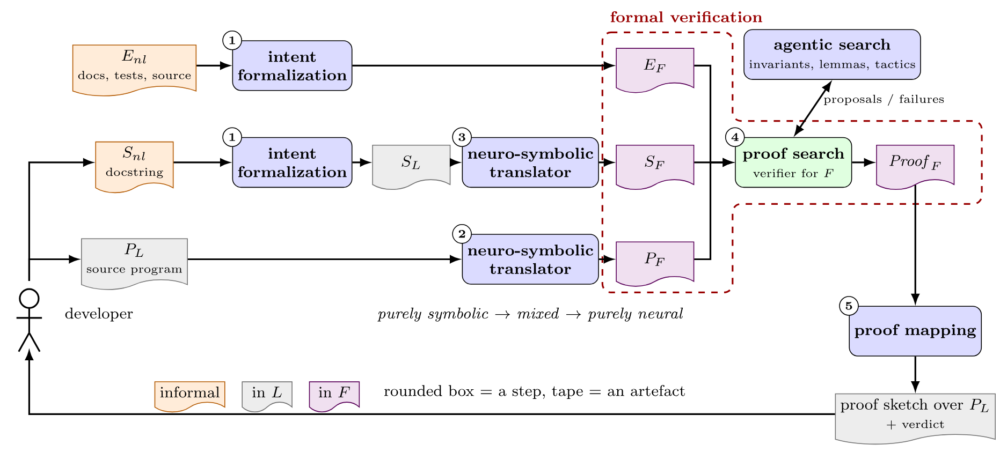
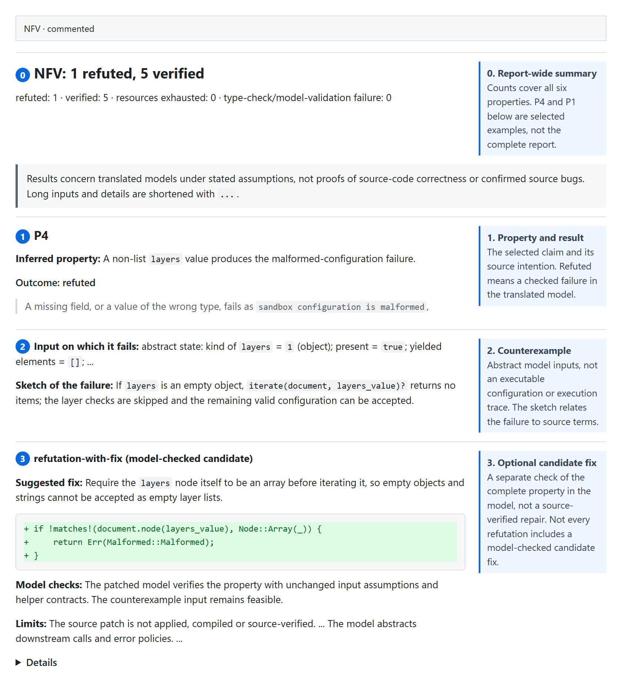
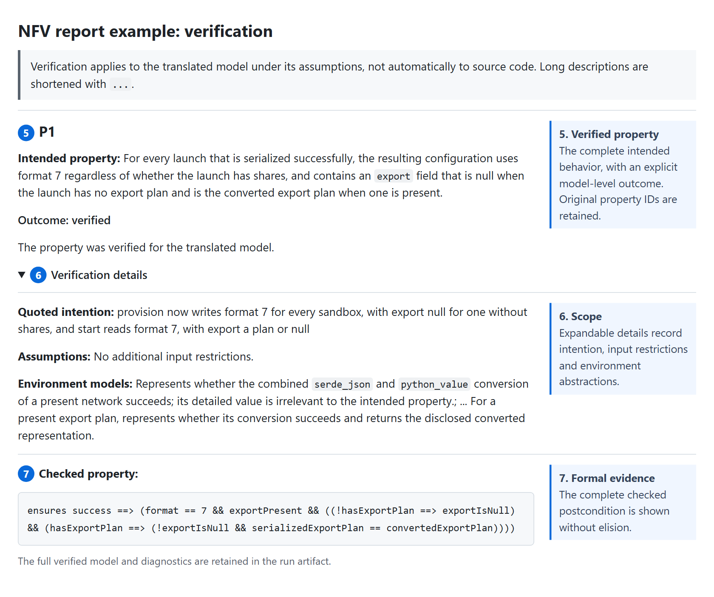
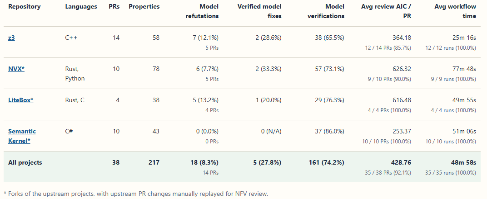

<!-- Copyright (c) Microsoft Corporation.
Licensed under the MIT License. -->

## TL;DR

**[Neuro-Formal Verification (NFV)](https://arxiv.org/abs/2608.21516)** is a framework for developing and empirically evaluating techniques that combine *agentic formalization* and *proof-based reasoning* to assess code against a given property.
We are releasing the code, **nfv-micro-bench** dataset and evaluation results in an [open-source repository](https://github.com/microsoft/neuro-formal-verification/).
The repository also contains a prototype **[Neuro-Formal Code Reviewer](https://github.com/microsoft/neuro-formal-verification/blob/dev/workflow/README.md)**, built with GitHub Agentic Workflows, that uses *[intent formalization](https://arxiv.org/abs/2603.17150)* to derive properties from PR descriptions, issues and discussions, then invokes NFV to seek proofs of verification or refutation.
We are sharing this early-stage research prototype to get feedback from researchers and developers and improve both the prototype and the underlying technique.

## The problem: scaling code review

**Code review is increasingly a bottleneck in the era of vibe coding.**
AI coding agents can turn a short prompt into substantial code changes.
Reviewers must check that the changes match the developer's *intent* without introducing unintended behavior.
Testing alone rarely covers all relevant inputs and execution paths, especially when behavior depends on interactions across a deep call chain.
AI reviewers can help, but their assessments can also miss real problems or invent nonexistent ones.

## What is NFV?

Over the past year, agents have made substantial progress in automating mathematical and program proofs at scale, helping developers use formal verifiers without formal-methods expertise.
But a machine-checked proof is only useful if it answers the right question about the original program.
**[Neuro-formal verification (NFV)](https://arxiv.org/abs/2608.21516)** is a framework for studying and developing techniques that combine neuro-symbolic agents with formal verifiers to seek proofs of verification or refutation for a given assertion or property.
Its three pillars are *environment formalization*, *language translation* and *proof automation*.
Agents formalize the code, supplied property and execution environment in a verification-aware language, then develop proofs for formal verifiers to check.
Translation can be neural, symbolic or mixed.
NFV is parameterized by the choice of backend program verifier, with mature verification tools and proof assistants such as Dafny, Lean and F\* offering possible backends.
**Agents translate; formal verifiers reason.**

The paper's evaluated pipeline formalizes library contracts and documented preconditions without seeing the target assertion, then freezes the translated computation, contracts and goals before proof search.
**Verification and refutation both produce procedure-modular proofs that scale with program size**: verification proves that the property holds in the model; refutation proves that it fails on a counterexample input.
A failed proof attempt leaves the question unresolved.
Every verdict requires a proof over the translated model and its assumptions, but the proof alone cannot establish that the formalization faithfully captures the source program and supplied property.
NFV therefore measures how accurately its proof-backed verdicts assess the original code, rather than claiming end-to-end soundness.

*[Architecture overview](https://arxiv.org/html/2608.21516#S1.F1).*

Reading the diagram from left to right, informal specifications and environment descriptions are formalized, while the source program and property are translated into a verification-aware language.
The resulting program model, property and environment contracts become the inputs to proof search.
With those inputs frozen, agents propose invariants, lemmas or tactics, using verifier feedback to refine their proof attempts rather than change the claim being checked.
Proof mapping then presents the verdict and a sketch of the reasoning in source terms, so the developer can inspect what was proved and under which assumptions.

The released **[nfv-micro-bench](https://github.com/microsoft/neuro-formal-verification/blob/dev/paper/data/nl2post_safe.json)**
contains small Python reference programs paired with incorrect mutants and
supplied assertions, drawn from [nl2postcond](https://arxiv.org/abs/2310.01831),
including HumanEval through EvalPlus.
Although the programs are small, they call real Python libraries whose behavior must be formalized accurately by the agents.
The combined Dafny pipeline achieves
**92.2% precision among issued verdicts**, correctly resolving **57.3% of
entries**. An LLM-as-judge baseline answers every
entry at about **72% precision**, but produces no verifiable artifact.
An unstaged agent-verifier baseline proves the supplied assertions for models of **98% of both references and mutants**, yielding only **50% precision**.

AI agents can chase the reward (here, obtaining a proof) by making the modeled problem easier (by overconstraining the environment, simplifying the code, or weakening the property); NFV aims to keep them honest by separating formalization from proof search and freezing the model between stages.

## Neuro-Formal Code Review

Neuro-Formal Code Review starts with **[intent formalization](https://arxiv.org/abs/2603.17150)**: deriving assertions or properties from PR descriptions, issues, discussions and captured source.
It then applies **NFV** to those properties.
Incorporating test-based specification-quality metrics (ongoing work) should help improve how faithfully the formalized properties capture developer intent.

The current prototype models the relevant code and environment in Dafny,
freezes the accepted model, and tries verification first, then refutation if needed.
It abstains from issuing a verdict when translation fails or resources run out.

The example report below contains **one refutation and five verifications**.
For the refuted property, it also provides a verified fix (on the model of the program)
that satisfies the original formalized property.

*An NFV refutation: property, counterexample, failure sketch and a verified fix
(on a formal model of the program).*

### An NFV proof

*For a verified property, the report shows the environment assumptions,
the property formalization and the verification evidence.*

## From microbenchmarks to real-world Pull Requests (PRs)

We have started applying the Neuro-Formal Code Reviewer to a few mature
Microsoft Research open-source projects across C++, Rust, Python, C and C#,
to see how well it works out of the box and across languages.
The table below covers a small sample of PRs from the past month in
Z3, NVX, LiteBox and Semantic Kernel.

We have installed the reviewer on [Z3](https://github.com/Z3Prover/z3), where
it has been commenting on PRs for the past few weeks and has contributed to
a few code fixes, including those discussed in
[Z3Prover/z3#10958](https://github.com/Z3Prover/z3/issues/10958) and
[Z3Prover/z3#10959](https://github.com/Z3Prover/z3/issues/10959).
For the other projects, we have applied the prototype to sampled PRs, and
early developer feedback has been encouraging.

**The refutations have not been fully vetted.** The prototype runs across
repositories and languages, but we still need to measure how accurate and
useful its findings are.

*The table shows the percentages of properties verified or refuted,
refutations with a verified model fix, average workflow runtime, and AI credit
usage (AIC) per PR. Fix percentages are among refutations. Asterisks mark
forks where upstream PR changes were manually replayed for NFV review.*

We also need to reduce runtime and AI credit (AIC) usage.
Measurements from real reviews will guide that work.

## The path ahead

With NFV, we aspire to build neuro-symbolic agents that can answer any Boolean question about a
program with very high accuracy (say, **99.99%**), while producing a proof artifact
that explains the verdict.

We are developing **labeled datasets representative of real-world pull requests**, together with **metrics** for evaluating accuracy, coverage and practical usefulness.
These benchmarks should distinguish failures in the code-review layer's **intent formalization** from NFV failures in **formalizing code**, **formalizing the execution environment**, or **translating the supplied property**.
We have already seen imprecise descriptions of PR intent lead to incorrect property formalizations.
In such cases, asking the developer to clarify their intent could help.
We want benchmark results and developer feedback to guide these improvements while keeping the tool general-purpose.
Alongside benchmarks and metrics, we want user studies to assess whether developers can understand the assumptions, evaluate the evidence and act on the results.
These studies should include developers without formal-methods expertise to help us judge whether the techniques are accessible and useful in practice.

We are working on additional backends, including Lean, F\* and Verus, to learn which work best for different programs and properties.

## Can I try it for my repo?

Start with the **[agent-assisted onboarding guide](https://github.com/microsoft/neuro-formal-verification/blob/dev/workflow/ONBOARDING.md)**.
It covers setup and a first pilot review.
We welcome research feedback on both the tool and the underlying technique.

### Acknowledgments

We thank **[Nikolaj Bj&oslash;rner](https://www.microsoft.com/en-us/research/people/nbjorner/)**
and **[Lev Nachmanson](https://www.microsoft.com/en-us/research/people/levnach/)**
for onboarding NFV on Z3 and for their feedback;
**[Peli de Halleux](https://www.microsoft.com/en-us/research/people/jhalleux/)**
and **[Ang&eacute;lica Moreira](https://www.microsoft.com/en-us/research/people/anmoreira/)**
for help with the Agentic Workflows integration; and
**[Pedro Henrique Penna](https://www.microsoft.com/en-us/research/people/ppenna/)**
and **[Jay Bosamiya](https://www.microsoft.com/en-us/research/people/jayb/)**
for their feedback on early NVX and LiteBox reports.
We also thank **[Tom Ball](https://www.linkedin.com/in/tball)**
for his feedback on an early preprint of the NFV paper.
